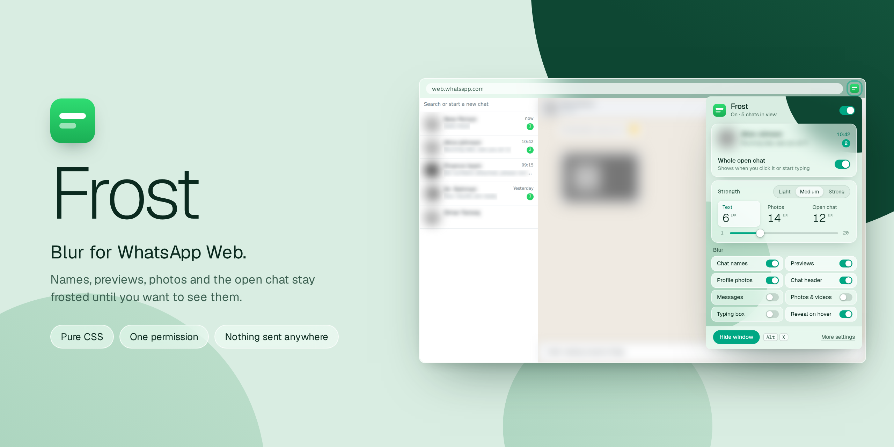
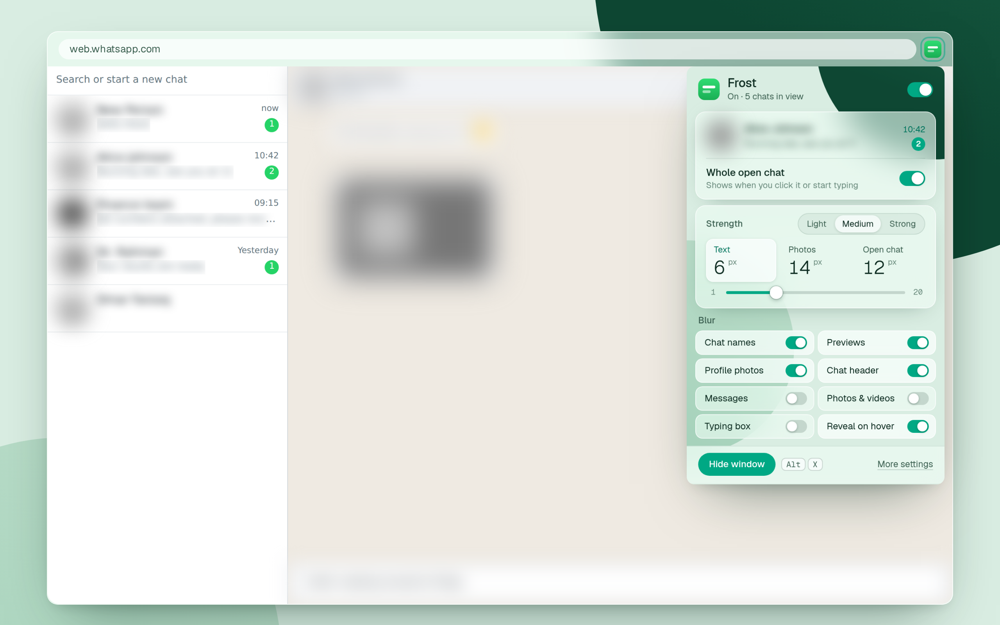
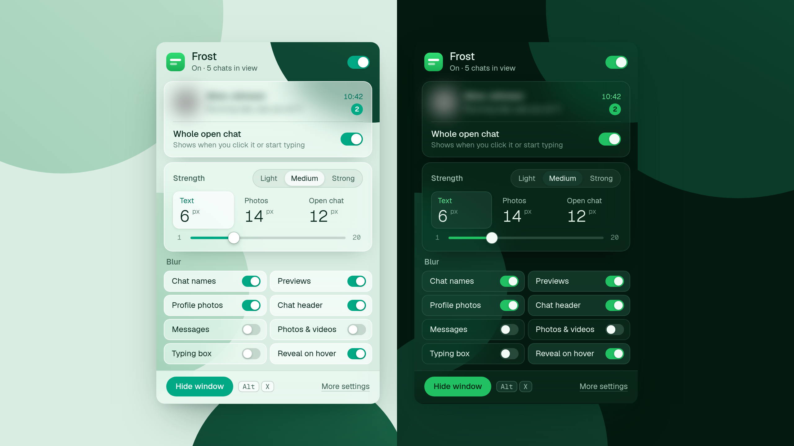
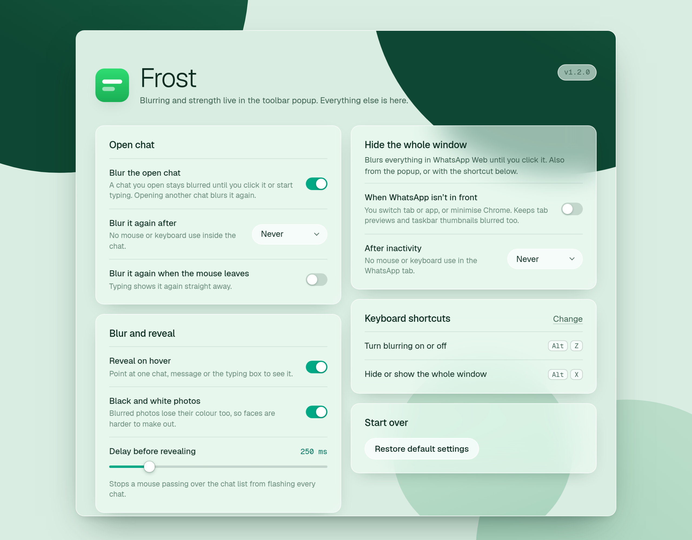

<p align="center">
  
</p>

<h3 align="center">Blur for WhatsApp Web, done entirely in CSS.</h3>

<p align="center">
  Chat names, last-message previews, profile photos and the open conversation stay frosted<br>
  until you want to see them. Nobody reading over your shoulder sees who you talk to or what they said.
</p>

<table align="center">
  <tr>
    <td align="center" width="200"><h2>1</h2>permission<br><sub><code>storage</code>, nothing else</sub></td>
    <td align="center" width="200"><h2>0</h2>network requests<br><sub>every connection is blocked</sub></td>
    <td align="center" width="200"><h2>0</h2>messages read<br><sub>blur is plain CSS</sub></td>
  </tr>
</table>

<br>

## How it looks

<p align="center">
  
</p>
<p align="center"><sub>WhatsApp Web with Frost on: names, previews and photos blurred in the list, and the open chat frosted until you click it. The chats are made-up test data.</sub></p>

<table>
  <tr>
    <td width="50%"></td>
    <td width="50%"></td>
  </tr>
  <tr>
    <td><sub><b>Popup.</b> A live preview, strength dials and a switch for everything that can be blurred. Follows the system's light or dark mode.</sub></td>
    <td><sub><b>Settings.</b> When the open chat blurs again, reveal on hover, hiding the whole window, shortcuts.</sub></td>
  </tr>
</table>

## Install

Frost isn't on the Chrome Web Store. Load it from this folder:

1. Download this repository (**Code → Download ZIP**) and unzip it, or `git clone` it.
2. Open `chrome://extensions` and turn on **Developer mode** (top right).
3. Click **Load unpacked** and choose the `extension` folder.
4. Pin Frost from the puzzle-piece menu, then reload WhatsApp Web if it was already open.

Works in Chrome, Edge, Brave and other Chromium browsers, version 111 or newer.

## What it does

<table>
  <tr>
    <td width="33%" valign="top"><b>Frosts the open chat</b><br><sub>The conversation stays blurred until you click it or start typing. The first click only reveals it, so you can't open a photo or link you couldn't see. Opening another chat blurs it again.</sub></td>
    <td width="33%" valign="top"><b>Blurs the chat list</b><br><sub>Names, previews and profile photos, each with its own switch. Times and unread badges stay readable. Hover one chat to peek at it.</sub></td>
    <td width="33%" valign="top"><b>Hides the whole window</b><br><sub>With one shortcut, when you switch away from WhatsApp, or after a few idle minutes. Clicks and keys are blocked until you come back.</sub></td>
  </tr>
</table>

**Blur, each one on or off in the popup**

| What | Default |
|---|---|
| Whole open chat (shows on click or typing) | on |
| Chat names | on |
| Last-message previews | on |
| Profile photos | on |
| Chat header (name and status line) | on |
| Messages in the open chat | off |
| Photos, videos and stickers | off |
| Typing box | off |

**Adjust**
- **Strength:** three dials (text 1–20 px, photos 2–40 px, open chat 2–40 px) sharing one slider, plus Light / Medium / Strong presets. The preview at the top of the popup follows as you drag.
- **Reveal on hover:** on or off, with a delay of 0–1.5 s so a mouse passing over the list doesn't flash every chat.
- **Black and white photos:** blurred photos lose their colour too, so faces are harder to make out.
- **Blur the open chat again:** after 15 s – 5 min with no activity in it, or whenever the mouse leaves it.

**Hide the whole window:** blurs everything and blocks clicks and typing until you click or press <kbd>Esc</kbd>.
- On demand: the popup's **Hide window** button, or <kbd>Alt</kbd>+<kbd>X</kbd>.
- Automatically when WhatsApp isn't in front (tab or app switch, minimise). Tab-hover previews and taskbar thumbnails stay blurred too.
- Automatically after a set time with no mouse or keyboard use in the tab.

**Shortcuts:** <kbd>Alt</kbd>+<kbd>Z</kbd> turns blur on or off, <kbd>Alt</kbd>+<kbd>X</kbd> hides or shows the window. Change them at `chrome://extensions/shortcuts`.

## Why it's safe

- **One permission:** `storage`. No host permissions, no `tabs`, no files exposed to websites, nothing other extensions or sites can connect to.
- **No network:**
  - The extension's pages carry a Content Security Policy with `connect-src 'none'`.
  - The content script runs in Chrome's isolated world, where WhatsApp's scripts can't reach it, and never calls `fetch`, `XMLHttpRequest`, `WebSocket`, `sendBeacon` or `postMessage`.
  - The tests grep the source to keep it that way, and fail if any request leaves the machine.
- **Never reads your chats:**
  - `src/content/frost.js` only sets attributes and four CSS variables on `<html>`, plus one marker attribute on the open chat panel. `src/content/frost.css` does all the blurring.
  - The script notices *where* you click or type (in the open chat, or on a chat in the list), never what's written there. Otherwise it only counts chat rows, so the popup can warn you if WhatsApp changes its layout.
  - A test fails if the script ever touches `textContent`, `innerHTML`, `.src`, `.title`, `getComputedStyle` and similar.
  - It answers status questions only from Frost's own pages, never from a script in a web page.
- **Nothing runs in WhatsApp's own JavaScript world.**
- **Settings stay in this browser:** `chrome.storage.local`, not synced to your Google account.

## How the CSS finds things

The selectors don't use WhatsApp's generated class names, which change with every deploy. They use:
- the IDs `#app`, `#pane-side` and `#main`;
- ARIA roles (`listitem`, `row`);
- every picture inside a chat-list row (profile photos load from several addresses, so the address isn't used);
- the footer's `contenteditable`;
- the shape of a chat row.

In a chat row, a titled span whose ancestor follows a sibling that also holds a titled span is on the second line, which makes it the preview. Every other titled span is the name. `:has()` expresses that in CSS alone, so new chats are blurred before they're ever painted.

For the open chat, the "shown" marker lives on the `#main` element itself:
- If WhatsApp builds a fresh panel for the next chat, it arrives without the marker and is blurred before it's painted.
- If WhatsApp reuses the panel, pressing a chat in the list (pointer down, or Enter) removes the marker before WhatsApp swaps the conversation in.

## When WhatsApp changes its layout

If the popup says *"No chats recognised"* while you're signed in, WhatsApp has probably changed its page structure. This snippet copies the *shape* of one chat row, with no names or messages in it, so the selectors can be fixed. Read it before you paste it into the DevTools console on web.whatsapp.com (never paste code you don't understand):

```js
(() => {
  const strip = (el, depth = 0) => depth > 7 ? '' :
    `${'  '.repeat(depth)}<${el.tagName.toLowerCase()}${[...el.attributes]
      .filter(a => ['id','role','title','dir','data-icon','contenteditable','src'].includes(a.name))
      .map(a => ` ${a.name}${a.name === 'title' ? `="…${a.value.length}"` : a.name === 'src' ? `="${a.value.split('/')[2] || a.value.slice(0, 5)}"` : `="${a.value}"`}`).join('')}>\n` +
    [...el.children].map(c => strip(c, depth + 1)).join('');
  const row = document.querySelector('#pane-side [role]');
  copy(strip(row?.closest('[role="listitem"],[role="row"]') || document.querySelector('#pane-side')));
  return 'Copied the structure of one chat row (no text) to the clipboard';
})();
```

Then adjust the selectors in `extension/src/content/frost.css`.

## Limits

- Blur is visual. It stops people reading over your shoulder; it does not encrypt anything.
- Desktop notifications are WhatsApp's own and are not changed. Turn off message previews in WhatsApp's notification settings if that matters to you.

## Tests

`test/e2e.cjs` runs:
1. Static checks: permissions, banned network APIs, and no page-reading in the content script.
2. The unpacked extension in Chromium, against a WhatsApp-shaped mock page served at `https://web.whatsapp.com` under a stricter CSP than the real one.
3. The popup and the settings page, driven like a user would.

```sh
PLAYWRIGHT=/path/to/node_modules/playwright node test/e2e.cjs [screenshot-dir]
```

The README images come from the same run:

```sh
node test/e2e.cjs shots && node docs/make-images.cjs shots
```

On WSL without sudo, Playwright's Chromium is missing NSS and ALSA. Fetch them without installing:

```sh
mkdir -p ~/.cache/pw-libs && cd /tmp && apt-get download libnspr4 libnss3 libasound2t64 \
  && for d in lib*.deb; do dpkg -x "$d" ~/.cache/pw-libs; done
export LD_LIBRARY_PATH=~/.cache/pw-libs/usr/lib/x86_64-linux-gnu
```

The "hide when WhatsApp isn't in front" check is skipped under automation, because Chromium driven by Playwright keeps the tab focused. Check it by hand: turn it on, switch to another app, and come back.

The mock mirrors WhatsApp's landmarks, not its exact markup. After any big WhatsApp redesign, check the real page by eye.

---

<sub>Fonts: Geist and Geist Mono, SIL Open Font License (`extension/fonts/OFL.txt`), used only in Frost's own popup and settings page. Frost is not affiliated with WhatsApp or Meta.</sub>
